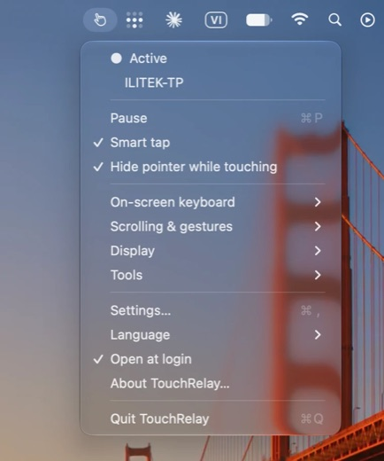
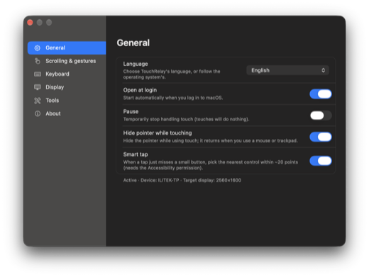
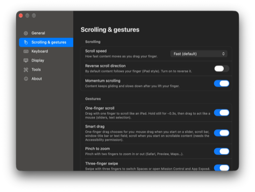
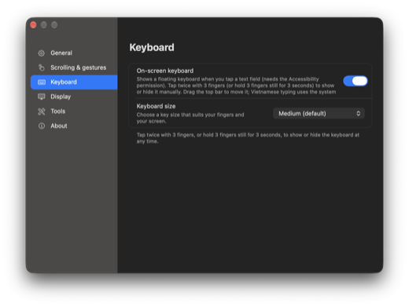
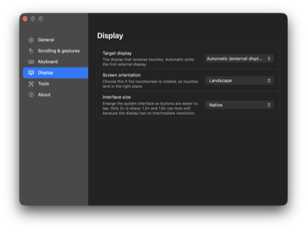
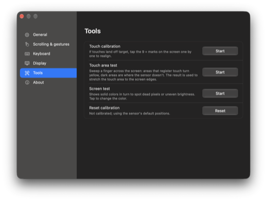

# TouchRelay for Mac

[Tiếng Việt](README.vi.md) · [Website](https://fpt-duongtx.github.io/touchrelay/) · [Disclaimer](DISCLAIMER.md) · [MIT License](LICENSE)

Make an **external USB touchscreen** work **natively on macOS**. macOS does not support third-party touchscreens: plug one in and it behaves like a one-point mouse. TouchRelay reads the raw HID touch reports, recognises gestures, and turns them into the events macOS apps already understand: clicks, drags, smooth scrolling with momentum, pinch-to-zoom and multi-finger swipes.

Pure Rust, **no dependencies**. IOKit, CoreFoundation and CoreGraphics are called through plain FFI. It runs as a small menu bar app and **never connects to the network**.

> **Unofficial and unsigned.** Not affiliated with Apple or any touchscreen maker. Read the [disclaimer](DISCLAIMER.md) before use.

## Screenshots

| | | |
|---|---|---|
|  |  |  |
|  |  |  |

## Gestures

| On the touchscreen | Result on macOS |
|---|---|
| Tap with 1 finger | Left click (two quick taps = double click) |
| Drag with 1 finger | **Smart:** mouse drag on sliders, scroll bars, window title bars and one-line text fields; scroll on scrollable content (web pages, lists) |
| Hold still ~0.3 s, then drag | Mouse drag anywhere: selection, files, windows |
| Drag with 2 fingers | Smooth pixel scrolling with **momentum** |
| Tap with 2 fingers | Right click |
| Pinch / spread | Zoom (Safari, Preview, Maps…) |
| Swipe 3 fingers left / right | Switch Space or full-screen app |
| Swipe 3 fingers up / down | Mission Control / App Exposé |
| Tap twice with 3 fingers, or hold 3 fingers still for 3 s | Show / hide the on-screen keyboard |
| Touch while gliding | Stops the scroll |

## Features

- **Smart drag**: one-finger drag picks mouse drag or scroll from what is under your finger (via Accessibility), so you rarely need the hold-to-drag.
- **On-screen keyboard**: a compact floating keyboard (physical layout, no function row; three sizes) that appears when you tap a text field. Drag its top bar to move it; tap twice with 3 fingers to show or hide it by hand. Keys send real key codes, so Vietnamese Telex/VNI input methods work, and a 🌐 key switches the input language (it shows the current one, e.g. EN or VI).
- **Hot-plug**: unplug and replug the screen any time.
- **Smart tap**: if a tap just misses a small button, TouchRelay uses the Accessibility API to pick the nearest control within ~20 points.
- **Touch calibration**: tap 9 marks to correct a sensor that is not linear near the edges (the one it was developed on is not).
- **Touch area test**: sweep a finger over the screen and see in yellow where the sensor detects touch; the measured range is used to reach the very edge (e.g. the menu bar).
- **Screen test**: solid colours to spot dead pixels.
- **Interface size**: temporarily enlarge the UI on the touchscreen (only 2× is sharp on most panels).
- **Pointer hiding**: the pointer is hidden while you use touch and comes back when you move a mouse or trackpad.
- Native settings window (sidebar + grouped forms), English and Vietnamese UI that follows the system language by default; pick a language in Settings or the menu (Language ▸) to override it.

## Tested hardware

| Touchscreen | Result |
|---|---|
| ILITEK-TP, `vid=0x222a pid=0x0001`, 10 touch points (2560×1600 panel) | Works |

Any "Windows compatible" screen that exposes a standard **HID Digitizer / Touch Screen** (usage `0x0D/0x04`) should work, because the layout is read from the HID report descriptor, not hard-coded. **Reports from other screens are very welcome**, see [Contributing](#contributing).

Notes learned the hard way with the ILITEK panel:

- It stays silent until the host writes the *Contact Count Maximum* feature report. TouchRelay does this from the descriptor.
- The sensor only covers ~90 % of the height of a 16:10 panel (it is a 16:9 sensor). In a 16:9 display mode with black bars the touch area matches the image exactly.

## Install

Requires macOS 13+ on Apple Silicon or Intel.

### Option A: build from source (recommended, no warnings)

```bash
# Rust (https://rustup.rs) and Xcode Command Line Tools: xcode-select --install
git clone https://github.com/fpt-duongtx/touchrelay.git
cd touchrelay
INSTALL=1 ./scripts/make-app.sh
open /Applications/TouchRelay.app
```

The script builds a release binary, creates `dist/TouchRelay.app`, signs it on your machine and (with `INSTALL=1`) copies it to `/Applications`. Options: `UNIVERSAL=1` for an Apple Silicon + Intel build, `SIGN_IDENTITY="…"` to use your own certificate, `BUNDLE_ID=…`.

### Option B: download the app (DMG)

1. Download `TouchRelay.dmg` (a universal Apple Silicon + Intel app) from the [latest release](https://github.com/fpt-duongtx/touchrelay/releases/latest). Its **MD5** (`.md5`) and SHA-256 (`.sha256`) checksums are published next to it. Optional check: `md5 -q ~/Downloads/TouchRelay.dmg`.
2. Open the DMG and drag **TouchRelay** onto **Applications**.
3. Open TouchRelay. Builds are **ad-hoc signed and not notarized by Apple** (the maintainer has no paid Developer ID), so macOS may block it: see [If macOS blocks the app](#if-macos-blocks-the-app).

**For the lazy: one paste in Terminal.** It downloads the latest DMG, checks the MD5, copies the app to Applications, marks it as trusted (removes the quarantine flag, so there is no Gatekeeper prompt) and opens it:

```bash
cd ~/Downloads
curl -fLO https://github.com/fpt-duongtx/touchrelay/releases/latest/download/TouchRelay.dmg
curl -fLO https://github.com/fpt-duongtx/touchrelay/releases/latest/download/TouchRelay.dmg.md5
[ "$(md5 -q TouchRelay.dmg)" = "$(cut -d' ' -f1 TouchRelay.dmg.md5)" ] && echo "MD5 OK" || echo "MD5 MISMATCH - stop here"
hdiutil attach -nobrowse -quiet -mountpoint /tmp/touchrelay-dmg TouchRelay.dmg
cp -R /tmp/touchrelay-dmg/TouchRelay.app /Applications/
hdiutil detach -quiet /tmp/touchrelay-dmg
xattr -dr com.apple.quarantine /Applications/TouchRelay.app
open /Applications/TouchRelay.app
```

> This skips Apple's own check, so **only run it if you trust this repository** and the MD5 says OK.
> Ad-hoc signatures change with every build, so macOS treats each new version as a new app and you may have to grant the two permissions again after updating.

### If macOS blocks the app

Because TouchRelay is not notarized, Gatekeeper may say it cannot verify the app. You can still open it once you trust it (once per version):

1. Open TouchRelay from Applications. When macOS says it could not verify the app, click **Done** (not *Move to Trash*).
2. Open **System Settings → Privacy & Security**, scroll to **Security**, and next to "TouchRelay was blocked to protect your Mac" click **Open Anyway**.
3. Enter your password or use Touch ID, then click **Open Anyway** once more.

On macOS 14 or earlier: Control-click the app → **Open** → **Open**. Terminal alternative: `xattr -dr com.apple.quarantine /Applications/TouchRelay.app`.

### Permissions (first launch)

TouchRelay asks for two permissions and opens the right Settings page for you:

- **Input Monitoring**: to read the touchscreen's HID reports.
- **Accessibility**: to post mouse and keyboard events, and to find the nearest button for Smart tap.

Turn both on for TouchRelay, then reopen it. If the app is listed but still refused, remove it with **−** and add it again.

## Using it

TouchRelay lives in the menu bar (☝︎ icon, no Dock icon). The menu is grouped by purpose:

- **Quick switches:** Pause, Smart tap, Hide pointer while touching
- **On-screen keyboard ▸:** auto-show, show now, size
- **Scrolling & gestures ▸:** scroll speed, reverse direction, momentum, one-finger scroll, smart drag, pinch, three-finger swipe, swipe sensitivity
- **Display ▸:** target display, orientation, interface size
- **Tools ▸:** calibration, touch area test, screen test, gesture guide, troubleshooting, command-line options, log
- **App:** Settings… (⌘,), Language ▸, Open at login, About, Quit

The Settings window mirrors this: General, Scrolling & gestures, Keyboard, Display, Tools, About.

Settings are stored in `~/Library/Application Support/touchrelay/settings.txt`, the log in `~/Library/Logs/touchrelay.log`.

### Touch is slightly off or the menu bar can't be tapped

1. Open the **Tools** page in Settings and run **Touch area test**. Sweep a finger over the whole screen, including the four edges, then tap with 3 fingers. If the edges stay dark, the sensor does not cover them; TouchRelay stretches the reachable range to the screen edge.
2. If taps are still off, run **Touch calibration** (9 marks).
3. If you changed the display resolution afterwards, the saved calibration is switched off automatically (it only applies to the resolution it was made for).

## Command line

```bash
cargo build --release
./target/release/touchrelay --list     # displays and touch devices
./target/release/touchrelay --debug    # print layout, every frame and action
```

When run from Terminal the permissions belong to Terminal, not to TouchRelay. Useful flags: `--display N`, `--swap-xy`, `--flip-x`, `--flip-y`, `--scroll-speed F`, `--invert-scroll`, `--one-finger-scroll`, `--no-momentum`, `--no-pinch`, `--no-swipe`, `--no-snap`, `--keep-cursor`, `--keep-mouse-interface`. See `touchrelay --help`.

## How it works

```
src/
├── main.rs      CLI, settings (Prefs)
├── hid_desc.rs  HID Report Descriptor parser (bit offsets of every field)
├── touch.rs     Descriptor → finger layout; report → frame (parallel + hybrid mode)
├── gesture.rs   Gesture state machine: tap / drag / hold / scroll + momentum / pinch / swipe
├── calib.rs     Per-axis piecewise-linear touch calibration + edge extents
├── coverage.rs  Touch-area map canvas
├── snap.rs      Smart tap (Accessibility)
├── display.rs   Interface size via display modes
├── i18n.rs      English / Vietnamese strings
├── macos.rs     IOKit seize, hot-plug, 120 Hz timer, Action → CGEvent
├── menubar.rs   Menu bar, Settings window, overlays (Objective-C runtime)
└── ffi.rs       CoreFoundation / IOKit / CoreGraphics declarations
```

It parses raw reports itself instead of calling `IOHIDDeviceGetValue`, which races when a screen sends several reports in a row. The logic in `hid_desc`, `touch`, `gesture`, `calib`, `coverage`, `snap` and `i18n` has no macOS dependency, so `cargo test` covers it (including a real ILITEK descriptor and report).

## Known limitations

- **No native macOS touch API.** macOS 27 has native touch for Apple hardware, but it exposes no public way for another app to inject or read touches. `NSScreen.touchCapabilities` measured `0` for the third-party screen used here, so TouchRelay synthesizes mouse, scroll and gesture events instead.
- **Not on the Mac App Store.** The sandbox blocks posting events, the Accessibility API and exclusive HID access.
- **Pinch-zoom uses a private, undocumented CoreGraphics gesture event** and pointer hiding uses a private connection property. Both may break in a future macOS.
- Only standard HID Digitizer screens are supported, not vendor drivers with a proprietary protocol.
- Three-finger swipes send `Ctrl + arrow`, so the Mission Control shortcuts must be enabled in System Settings → Keyboard → Keyboard Shortcuts.
- Interface size uses display modes only for the session and is restored on quit; if the app is killed it may stay until you change it in System Settings → Displays.

## Contributing

Issues and pull requests are welcome. If your touchscreen does not work, please [open an issue](https://github.com/fpt-duongtx/touchrelay/issues) with the output of:

```bash
./target/release/touchrelay --list
```

and the `ReportDescriptor (… byte): …` line printed by `./target/release/touchrelay --debug` (it contains no personal data). Add a test in `src/touch.rs` using your descriptor when you fix a layout problem.

## License and disclaimer

[MIT](LICENSE). See the [disclaimer](DISCLAIMER.md): the software is provided as is, without warranty, and is not affiliated with Apple or any hardware vendor.

Contact: [GitHub Issues](https://github.com/fpt-duongtx/touchrelay/issues).
